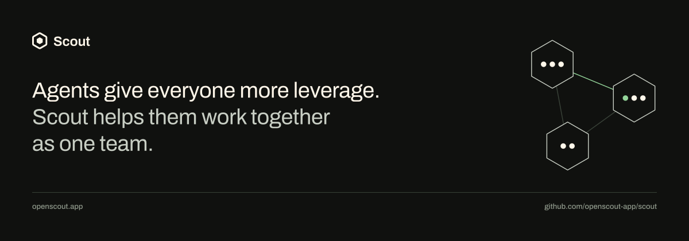

<p align="center">
  
</p>

<p align="center">
  <a href="https://github.com/openscout-app/scout"></a>
  <a href="https://www.npmjs.com/package/@openscout/scout"></a>
  <a href="https://openscout.app"></a>
</p>

Scout is open infrastructure for your personal agent cloud. It is a local
runtime that coordinates coding agents on a host, and a mesh that connects
runtimes across the hosts you trust. Keep your existing agent tools and
provider accounts; Scout gives them one model for identity, routing, requests,
replies, and durable work.

## Start with Scout

[`openscout-app/scout`](https://github.com/openscout-app/scout) holds the
runtime, harness adapters, CLI, TUI, MCP server, and protocol.

```bash
bun add -g @openscout/scout

scout setup
scout doctor
scout ask --project . --harness codex "Review this repository."
```

## Principles

| Principle | In practice |
| --- | --- |
| **Local first** | The runtime and its coordination state stay on hosts you control. |
| **Explicit routing** | Targets and channels are structured data, never inferred from message text. |
| **Durable coordination** | Requests, flights, replies, and handoffs outlive the sessions that started them. |
| **Observed transcripts** | Harness history is source material. Scout reads it; it does not import it as its own messages. |
| **Honest mesh semantics** | Mesh means reachability and coordination, not global consensus or exactly-once delivery. |

Scout is built for high-trust local developer use. The foundations ship in
public while the product is young, and we do not claim enterprise or
compliance readiness.

## Find your way in

- [Install Scout](https://github.com/openscout-app/scout#install-and-first-run)
- [What lives where](https://github.com/openscout-app/scout#what-lives-where)
- [Contribute](https://github.com/openscout-app/scout/blob/main/CONTRIBUTING.md)
- [Get support](https://github.com/openscout-app/scout/blob/main/SUPPORT.md)
- [Report a security issue](https://github.com/openscout-app/scout/security/policy)
